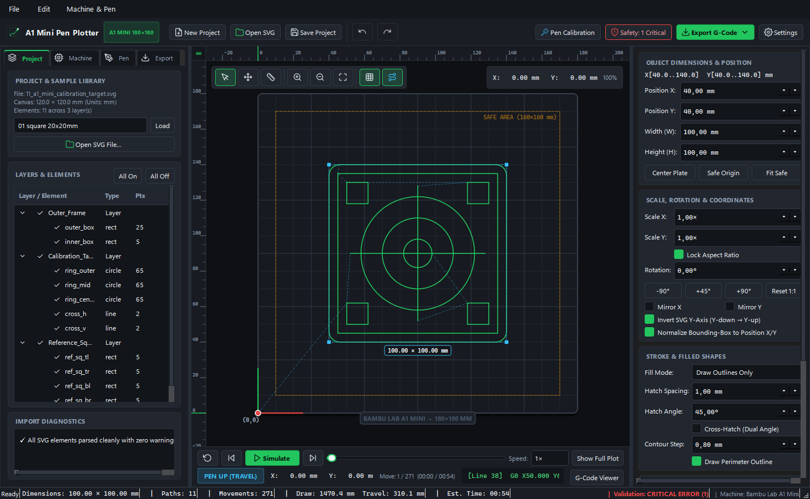
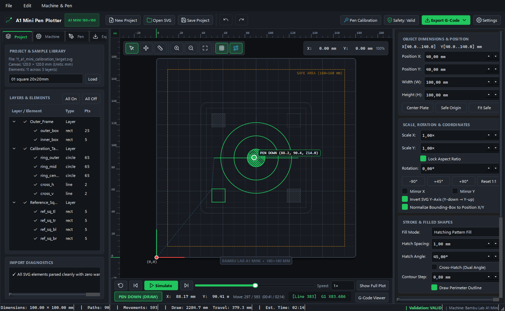
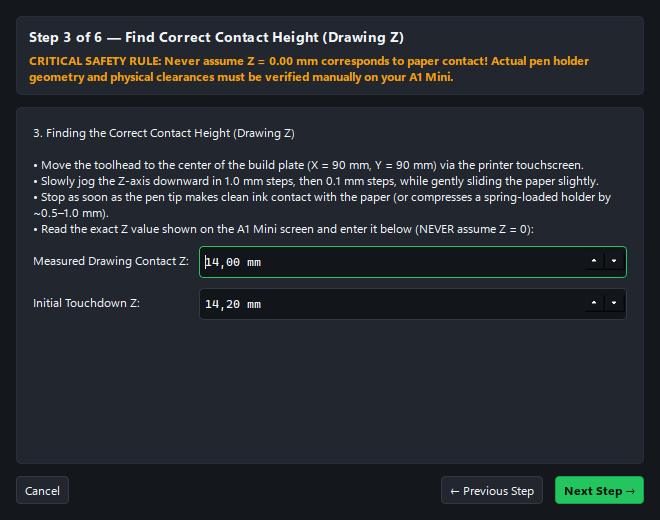
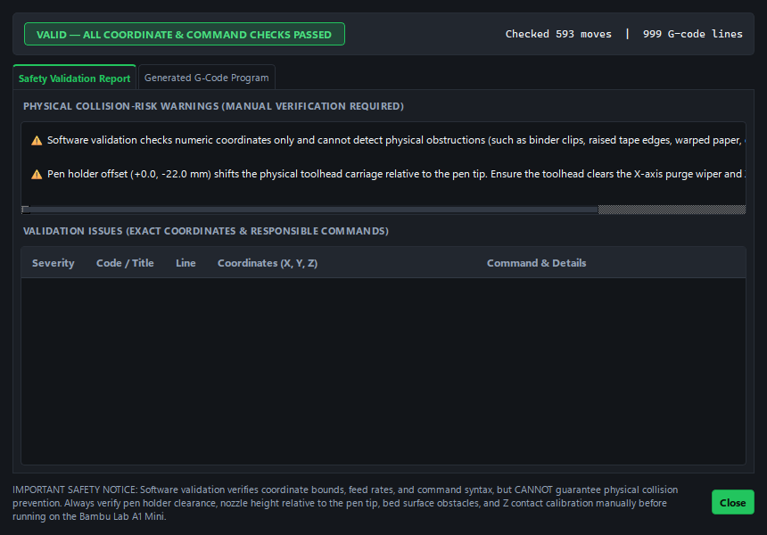

<div align="center">

# A1 Mini Pen Plotter

**Dedicated SVG-to-G-code Preparation Studio for the Bambu Lab A1 Mini**

[](https://github.com/Hansolox80/a1-mini-pen-plotter/releases/tag/v1.1.0)
[](https://www.python.org/)
[](https://doc.qt.io/qtforpython-6/)
[](https://github.com/Hansolox80/a1-mini-pen-plotter/releases)
[](tests/)
[](LICENSE)
[-green.svg)](https://bambulab.com/en/a1-mini)

*A full-featured, native desktop application engineered specifically for converting vector artwork into precise, physically validated plotting trajectories without risking nozzle crashes, bed collisions, or firmware errors.*

<br/>



</div>

---

## Table of Contents

- [About the Project](#about-the-project)
- [Rigorous Mechanical Safety Warnings](#rigorous-mechanical-safety-warnings)
- [Key Features](#key-features)
  - [1. Precision Vector Import & Geometry Engine](#1-precision-vector-import--geometry-engine)
  - [2. Interactive 180 × 180 mm A1 Mini Build Plate](#2-interactive-180--180-mm-a1-mini-build-plate)
  - [3. Shape Hatching & Contour Fills](#3-shape-hatching--contour-fills)
  - [4. Toolpath Optimization (Nearest-Neighbor & 2-Opt)](#4-toolpath-optimization-nearest-neighbor--2-opt)
  - [5. Independent G-Code Generator & Bambu Workflows](#5-independent-g-code-generator--bambu-workflows)
  - [6. Live Toolpath Simulator & Inspector](#6-live-toolpath-simulator--inspector)
  - [7. Mandatory Multi-Tier Safety Validation](#7-mandatory-multi-tier-safety-validation)
- [Screenshots](#screenshots)
- [Installation](#installation)
  - [Option A: Standalone Windows Binary (Recommended)](#option-a-standalone-windows-binary-recommended)
  - [Option B: Running from Source (Python 3.12+)](#option-b-running-from-source-python-312)
- [Step-by-Step Pen Calibration Guide](#step-by-step-pen-calibration-guide)
- [Bambu Lab A1 Mini Compatibility Matrix](#bambu-lab-a1-mini-compatibility-matrix)
- [Building the Windows Executable](#building-the-windows-executable)
- [Running Automated Tests](#running-automated-tests)
- [Contributing](#contributing)
- [License & Credits](#license--credits)

---

## About the Project

Standard 3D slicers are designed to melt plastic in 3D space with continuous extrusion, retractions, and rapid accelerations. When turning a 3D printer into a pen plotter, standard slicing logic fails:
- Slicers heat the hotend and bed, risking scorching paper or burning ink.
- Automatic bed leveling and vibration tests shake the toolhead violently, loosening pen brackets.
- Standard start macros run the toolhead across nozzle wipers, snapping pen nibs.

**A1 Mini Pen Plotter** replaces standard slicing with a dedicated, ground-up conversion and validation engine built exclusively for 2D mechanical plotting on the **Bambu Lab A1 Mini**:
- Pure cold-plotting G-code (`M104 S0`, `M140 S0`).
- Nozzle wipe and accelerometer resonance calibration macros are completely omitted.
- Seamless dual execution workflows: **Direct MicroSD Card execution** (`.gcode`) and **Bambu Studio package** (`.gcode.3mf`).
- Strict software boundary and Z-height safety validation before allowing file export.

---

## Rigorous Mechanical Safety Warnings

> [!CAUTION]
> **READ CAREFULLY BEFORE ATTACHING A PHYSICAL PEN TO YOUR BAMBU LAB A1 MINI**

1. **NEVER ASSUME Z = 0 IS PAPER CONTACT**:
   In 3D printing, $Z = 0$ corresponds to the nozzle tip touching the print bed. Pen holder brackets clamp pens such that the pen tip extends **below** the nozzle by $4\text{ to }10\text{ mm}$. If your printer moves to $Z = 0$, the pen will crash violently into the build plate, bending the nib or damaging the toolhead carriage. Always find your actual contact height ($Z_{\text{draw}} \approx 12\text{–}15\text{ mm}$ depending on your bracket) using the built-in [Pen Calibration Wizard](#step-by-step-pen-calibration-guide).
2. **HOMING PROCEDURE WITH A PEN MOUNTED**:
   Sensorless homing touches the plate or soft stops. **Always home the printer from the touchscreen (`Control → Home`) BEFORE inserting the pen low into the clamp**. Never home axes while the pen is locked in a lowered position.
3. **USE A SPRING-LOADED PEN HOLDER**:
   A rigid pen mount offers zero vertical compliance. Slight variations in paper thickness, tape folds, or bed mesh will either cause lines to skip or crush the pen nib. Using a spring-loaded adapter (readily available on MakerWorld/Printables) absorbs tolerances safely.
4. **ALWAYS PERFORM AN "AIR DRAW" TEST FIRST**:
   Before letting the pen touch paper, perform your initial dry run with the pen removed or clamped high ($5\text{ mm}$ above the paper). Verify that all movements, Z lifts, and boundary clearances behave as expected.
5. **AVOID BINDER CLIPS OR RAISED OBSTRUCTIONS**:
   Secure your paper to the 180 × 180 mm textured PEI plate using low-profile blue painter's tape along the margins. Do not use bulky metal binder clips that could collide with the X-axis carriage, gantry, or rear purge wiper.

---

## Key Features

### 1. Precision Vector Import & Geometry Engine
- **Supported Vector Primitives**: `<path>`, `<rect>` (with rounded corners `rx`/`ry`), `<circle>`, `<ellipse>`, `<line>`, `<polyline>`, `<polygon>`, and `<text>`/`<tspan>`.
- **Curve Flattening**: Adaptive De Casteljau subdivision for cubic and quadratic Bézier curves and high-precision elliptical arc parameterization (W3C SVG 1.1 Appendix F.6).
- **Matrix Composition**: Full $3 \times 3$ affine transformation evaluation across nested groups (`<g>`) and `<use>` elements (`matrix`, `translate`, `scale`, `rotate`, `skewX`, `skewY`).
- **Unit Fidelity**: Correct interpretation of physical units (`mm`, `cm`, `in`, `pt`, `pc`) and standard CSS pixels (`96 DPI`), with `viewBox` mapping and aspect ratio preservation.
- **Diagnostics Reporting**: Unsupported non-vector tags (`<image>`, `<foreignObject>`, `<filter>`, `<mask>`, `<clipPath>`) are never silently ignored—every occurrence is flagged in the **Import Diagnostics** panel.

### 2. Interactive 180 × 180 mm A1 Mini Build Plate
- Top-down visual representation of the Bambu Lab A1 Mini PEI build plate (`180 × 180 mm`).
- **Precision Rulers & Grid**: Pinned top and left millimeter rulers with live cursor crosshair ticks. Dual grid system featuring a $1\text{ mm}$ fine grid (when zoomed), a $10\text{ mm}$ minor grid, and a $30\text{ mm}$ major grid.
- **Safety Margins**: Visualizes the configured usable area ($160 \times 160\text{ mm}$ default) with amber dashed borders and safety exclusion zones.
- **Interactive CAD Tools**:
  - **Select & Move (`V`)**: Drag drawings directly across the build plate with real-time coordinate updates and Undo/Redo (`Ctrl+Z` / `Ctrl+Y`).
  - **Pan (`H` or Middle/Right Drag)** and **Cursor-Centered Wheel Zoom**.
  - **Point-to-Point Measurement Tool (`M`)**: Inspect exact $\Delta X$, $\Delta Y$, distance $D$ (`mm`), and angle ($^\circ$).

### 3. Shape Hatching & Contour Fills
- **Draw Outlines Only**: Plots the perimeter contours of closed shapes.
- **Ignore Fills**: Discards fills while preserving explicit stroke paths.
- **Linear Hatching**: Fills closed polygons (including shapes with interior holes) with parallel lines. Features configurable line spacing (`mm`), angle ($^\circ$), and optional dual-angle cross-hatching. Scan direction alternates on each pass to eliminate unnecessary travel moves.
- **Concentric Contours**: Generates inward offset concentric rings using Shapely polygon buffering.

### 4. Toolpath Optimization (Nearest-Neighbor & 2-Opt)
Plotting unoptimized SVG paths wastes up to 70% of total job time on rapid travel moves in the air. A1 Mini Pen Plotter incorporates four optimization strategies:
- **Original SVG Order**: Preserves the authoring sequence.
- **Direction Optimization Only**: Reverses path directions where travel distance is reduced.
- **Nearest-Neighbor**: Greedily schedules the closest path start or end point.
- **Minimum Travel (Nearest-Neighbor + 2-Opt)**: Refines nearest-neighbor ordering with iterative 2-opt edge-exchange local search.
- **Endpoint Merging**: Automatically joins contiguous path segments within a configurable threshold to eliminate redundant pen lifts.

### 5. Independent G-Code Generator & Bambu Workflows
Outputs clean, structured, and commented G-code with three execution options:
1. **A1 Mini Direct MicroSD Execution (`.gcode`)**: Minimal cold start routine (`M104 S0`, `M140 S0`, `M106 S0`, `G28`, immediate lift to Safe Z). Copy directly to the root of the A1 Mini MicroSD card and launch from the touchscreen.
2. **Bambu Studio Package (`.gcode.3mf`)**: Open Packaging Conventions ZIP archive bundling `Metadata/plate_1.gcode`, `plate_1.gcode.md5`, `slice_info.config`, `3D/3dmodel.model`, and rendered PNG plate thumbnail. Double-click to open in Bambu Studio and print over Wi-Fi.
3. **Standard Generic Plotter (`.gcode`)**: Pure `G21`/`G90`/`G0`/`G1`/`G4` G-code for universal CNC and plotter firmware.

### 6. Live Toolpath Simulator & Inspector
- Real-time animated trajectory preview matching physical feed rates.
- Full transport controls: Play/Pause, Restart, Step Forward, Step Backward, speed slider ($0.25\times\text{ to }25\times$), and scrub bar.
- Progressive rendering showing completed paths, current move, and upcoming paths.
- Active toolhead indicator displaying instantaneous $(X, Y, Z)$ coordinates and **PEN UP / PEN DOWN** status.
- Real-time G-code line and command inspector.

### 7. Mandatory Multi-Tier Safety Validation
Before any execution-ready file can be exported, the mandatory validation engine checks:
- $X/Y$ coordinates against the physical $180 \times 180\text{ mm}$ build volume and safety margins.
- Z heights against safe bounds and verifies that $\text{Pen-Up Z} > \text{Drawing Z}$.
- Detects and flags negative coordinates ($< 0\text{ mm}$).
- Ensures travel and drawing feed rates do not exceed machine limits.
- Validates the pen transition state machine (no drawing with pen lifted; pen lifted at job end).
- Blocks forbidden commands (`M104 > 0`, `M109`, `M140 > 0`, `M190`, extrusion moves `G1 ... E...`, `G29`).
- **Critical errors strictly block export** and display the exact line number, coordinate, and command responsible.

---

## Screenshots

| Main Desktop Workspace | Live Simulator & Cross-Hatching |
| :---: | :---: |
|  |  |

| 6-Step Pen Calibration Wizard | Safety Validation & G-Code Inspector |
| :---: | :---: |
|  |  |

---

## Installation

### Option A: Standalone Binary Packages (Recommended)
No Python installation required.

* **Windows (x64)**:
  1. Download `A1-Mini-Pen-Plotter-v1.1.0-windows-x64.zip` from the [Releases](https://github.com/Hansolox80/a1-mini-pen-plotter/releases) page.
  2. Extract the archive and double-click **`A1 Mini Pen Plotter.exe`**.
  3. *(Optional)* Run `scripts\install_windows.ps1` to create Desktop & Start Menu shortcuts.
* **Linux (x64)**:
  1. Download `A1-Mini-Pen-Plotter-v1.1.0-linux-x64.tar.gz` from [Releases](https://github.com/Hansolox80/a1-mini-pen-plotter/releases).
  2. Extract and run `./A1\ Mini\ Pen\ Plotter/A1\ Mini\ Pen\ Plotter`.
* **macOS (Apple Silicon & Intel)**:
  1. Download `A1-Mini-Pen-Plotter-v1.1.0-macos.dmg` from [Releases](https://github.com/Hansolox80/a1-mini-pen-plotter/releases).
  2. Drag **`A1 Mini Pen Plotter.app`** to your Applications folder.

### Option B: Running from Source (Python 3.12+)

```bash
# 1. Clone the repository
git clone https://github.com/Hansolox80/a1-mini-pen-plotter.git
cd a1-mini-pen-plotter

# 2. Create and activate a virtual environment
# On Windows:
python -m venv .venv
.\.venv\Scripts\activate

# On Linux / macOS:
python3 -m venv .venv
source .venv/bin/activate

# 3. Install dependencies
pip install -r requirements.txt

# 4. Generate resources and seed default profiles
python scripts/generate_assets.py

# 5. Run the application
python app/main.py
```

---

## Step-by-Step Pen Calibration Guide

The application includes an interactive **6-Step Pen Calibration Wizard** accessible via the top toolbar button (**Pen Calibration**):

```
┌────────────────────────────────────────────────────────┐
│               PEN CALIBRATION WIZARD                   │
├────────────────────────────────────────────────────────┤
│ Step 1: Install Physical Pen Holder & Tape Paper       │
│ Step 2: Check Pen Tip Position & XY Offsets            │
│ Step 3: Find Correct Contact Height (Drawing Z)        │
│ Step 4: Configure Safe Lifted Height (Pen-Up Z)         │
│ Step 5: Test Short Drawing Movement (20mm Test Pattern)│
│ Step 6: Save Calibrated Profile ([Calibrated] Flag)    │
└────────────────────────────────────────────────────────┘
```

1. **Step 1 — Mount & Clearances**:
   Unload filament, ensure nozzle and bed are at $0^\circ\text{C}$, attach the bracket, tape paper flat, and home the printer (`Control → Home`) on the printer screen.
2. **Step 2 — Pen Tip Protrusion**:
   Raise $Z$ to $35\text{ mm}$. Clamp the pen so its tip extends $4\text{ to }8\text{ mm}$ below the nozzle tip. Measure any $X/Y$ offset between nozzle center and pen center (e.g. $Y = -22\text{ mm}$).
3. **Step 3 — Measure Contact Height ($Z_{\text{draw}}$)**:
   Jog the toolhead to center $(X=90, Y=90)$. Lower $Z$ in $1.0\text{ mm}$ then $0.1\text{ mm}$ increments while gently moving a piece of paper. The instant the pen tip makes contact (or lightly compresses a spring mount by $0.5\text{ mm}$), note the screen's Z value (typically $12.0\text{–}15.0\text{ mm}$) and enter it as **Drawing Z**.
4. **Step 4 — Configure Safe Lifted Height ($Z_{\text{up}}$)**:
   Set the **Lift Height ($\Delta Z$)** ($3.0\text{ to }5.0\text{ mm}$). The resulting **Pen-Up Z** ($Z_{\text{draw}} + \Delta Z \approx 17.0\text{–}19.0\text{ mm}$) ensures rapid moves clear tape edges and surface ripples.
5. **Step 5 — Test Movement**:
   Export the generated $20 \times 20\text{ mm}$ calibration test square G-code and run it to verify line quality and safe pen lifts.
6. **Step 6 — Save Profile**:
   Save the profile. It will be marked as **`[Calibrated]`** in the UI, enabling clean safety verification.

---

## Bambu Lab A1 Mini Compatibility Matrix

| Workflow Mode | Output Extension | How to Run on Bambu Lab A1 Mini |
| :--- | :--- | :--- |
| **A1 Mini Direct MicroSD** | `.gcode` | Copy `.gcode` to the **root directory** of the MicroSD card. Insert into the A1 Mini, select **Print Files → MicroSD**, select your file, and press **Print**. |
| **Bambu Studio Container** | `.gcode.3mf` | Open the `.gcode.3mf` file in Bambu Studio (`File → Open`). Inspect toolpath preview and estimated time, then click **Print Plate** to send over Wi-Fi. |
| **Standard Generic Plotter** | `.gcode` | Universal plotter G-code (`G21`/`G90`/`G0`/`G1`/`G4`) for non-Bambu machines or custom controllers. |

---

## Building the Windows Executable

The project includes an automated build pipeline script (`build_windows.bat`) that verifies all dependencies, runs automated tests, and packages the standalone distribution using PyInstaller:

```cmd
### Building for Windows, Linux, and macOS

* **Windows**: Run `build_windows.bat` (bundles `dist\A1 Mini Pen Plotter\A1 Mini Pen Plotter.exe`).
* **Linux**: Run `chmod +x build_linux.sh && ./build_linux.sh` (bundles standalone binary and tarball).
* **macOS**: Run `chmod +x build_macos.sh && ./build_macos.sh` (bundles `.app` bundle and `.dmg`).

### Packaging a GitHub Release Archive
To generate a release `.zip` with SHA-256 and MD5 checksums ready for GitHub Releases:
```powershell
powershell -ExecutionPolicy Bypass -File scripts\package_release.ps1
```
Output: `dist\A1-Mini-Pen-Plotter-v1.1.0-windows-x64.zip`.

---

## Running Automated Tests

A comprehensive test suite of 42 unit, safety, fuzzing, concurrency, and UI integration tests is provided in [`tests/`](tests/):

```powershell
pytest -v
```

Full technical report and QA findings available in [`BUG_HUNT_LOG.md`](BUG_HUNT_LOG.md).

### Verified Test Cases:
- **Square Dimensions**: Physical $20 \times 20\text{ mm}$ square toolpath within $0.001\text{ mm}$ tolerance.
- **Circle Dimensions**: $20\text{ mm}$ diameter circle bounding box and circumference ($20\pi\text{ mm}$).
- **Diagonal Vectors**: Line length calculation $\sqrt{\Delta X^2 + \Delta Y^2}$.
- **Curve Flattening**: Adaptive cubic Bézier, quadratic Bézier, and elliptical arcs.
- **Optimization Benchmark**: Nearest-Neighbor and 2-Opt travel distance reduction.
- **ViewBox Scaling**: Physical scaling from unitless viewBox user units.
- **Nested Transforms**: Matrix composition across nested `<g>` elements.
- **Negative Coordinates**: Immediate detection and critical safety blocking.
- **Oversized Documents**: Documents exceeding $180 \times 180\text{ mm}$ rejected by safety validator.
- **Imperial Units**: $1\text{ in} \times 1\text{ in}$ square accurately converted to $25.40 \times 25.40\text{ mm}$.
- **UI Integration**: MainWindow, Canvas, Simulator, Undo/Redo stack, and Dialog logic.

---

## Contributing

Contributions are welcome! Please read [CONTRIBUTING.md](CONTRIBUTING.md) for details on code style, safety guidelines, and the Pull Request submission process.

---

## License & Credits

- **License**: Released under the permissive [MIT License](LICENSE). Copyright &copy; 2026 A1 Mini Pen Plotter Engineering.
- **Core Dependencies**: [PySide6 (Qt for Python)](https://doc.qt.io/qtforpython-6/), [Shapely](https://shapely.readthedocs.io/), [svgpathtools](https://github.com/mathandy/svgpathtools), [NumPy](https://numpy.org/), [Pillow](https://python-pillow.org/), [PyInstaller](https://pyinstaller.org/).
- **Hardware Inspiration**: Bambu Lab A1 Mini & the 3D printing open-source pen-plotting community.
